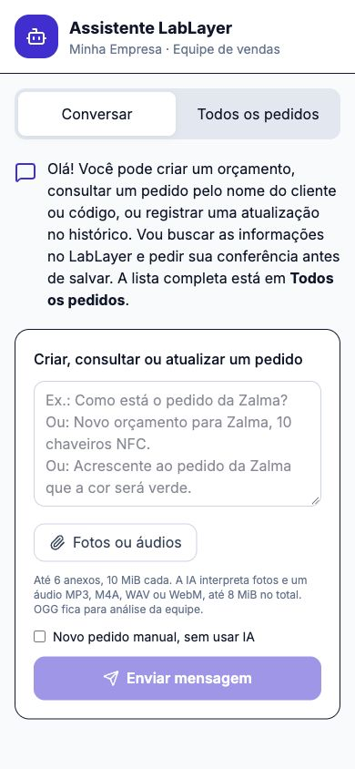

# Assistente: criar, consultar e complementar pedidos

A aba **Conversar** substitui “Novo pedido”. A mesma caixa recebe pedidos novos, perguntas sobre pedidos existentes e informações adicionais. Mantém o link público compartilhado já ativado, o modelo GPT-6 Luna e a credencial existente no n8n.

## Comportamento

- “Novo orçamento: cliente Ana, 10 chaveiros” prepara o formulário; só cadastra após confirmação.
- “Como está o pedido da Ana?” ou um código ORC procura os registros autorizados e oferece seleção. Ao selecionar, mostra descrição, quantidade, situação, valor disponível, anexos e histórico atuais do LabLayer.
- “Acrescente ao pedido da Ana: cliente confirmou azul” prepara um complemento. O vendedor seleciona o pedido, confere/edita o texto e confirma o registro no histórico.
- “Tem alguma atualização do pedido?” é consulta de andamento, não alteração.
- Dentro do detalhe, “E o valor?” usa o pedido selecionado. Uma referência explícita a outro pedido tem prioridade.
- Não há edição automática de quantidade, preço, estoque, aprovação ou status. Solicitações de mudança ficam documentadas no histórico para a equipe executar no orçamento.
- Novo pedido manual e complemento manual continuam disponíveis. Falha da IA ou intenção indefinida não converte perguntas em novos orçamentos.

## Contrato e autorização

`POST /api/assistant/draft` aceita `conversation: true` e `requestId` opcional. Sem a opção mantém o contrato anterior. A IA retorna `intent` (`create`, `lookup`, `update`, `clarify`), `query`, `note` e `question` em JSON estrito. Só `create` contém rascunho. A IA recebe a mensagem/anexos e a indicação booleana de contexto; não recebe o banco de clientes, preços ou identificadores internos do contexto.

O servidor autoriza o contexto antes da chamada, revalida o acesso após o retorno e pesquisa apenas dentro da empresa do link. A opção de compartilhamento da empresa continua determinando se o link pode consultar todos ou somente seus pedidos. Resultados de consulta vêm diretamente do banco; a IA não redige preços ou situação.

Pesquisa por código/ID, título e cliente sem distinção de acentos/maiúsculas. Todos os termos devem ocorrer. Busca limitada a 1.000 documentos e 20 resultados por mensagem; resposta avisa quando parcial e orienta usar a lista paginada. Não há pesquisa aproximada nem memória de mensagens anteriores: o contexto é o pedido aberto. Complementos continuam idempotentes e sujeitos às cotas/regras existentes.

O workflow n8n existente permanece compatível: o esquema segue enviado pelo servidor e o envelope mantém `schemaVersion: 1`, `requestId`, `suggestion`, `transcript`. Nenhum segredo novo.

## Validação

Somente suítes do bot, conforme solicitado:

- 15 testes unitários/UI: intake/anexos, contrato IA/tickets, conferência, repetição segura, consulta e complemento.
- 29 testes de integração: acesso, compartilhamento, anexos, cotas, revogação, cadastro, consulta, isolamento e idempotência.
- TypeScript e build de produção aprovados. Build mantém aviso de bundle maior que 500 kB, anterior a esta mudança.
- Verificação publicada com IA real em tenant QA separado: 15 verificações aprovadas em `evidencias/assistente-conversa-20261021.json`. Fixture removida e acesso de IA de teste retirado. Hash dos 27 orçamentos reais preservado. Consulta à Zalma validada pela interface publicada e tela mobile conferida a 390 × 844.

Publicação usa backup de código e índice anterior, verificação SHA-256 do servidor e health check. Não há migração de dados. O repositório principal recebe o mesmo patch preservando suas regras de autorização de proprietário.

## Publicação concluída

Código publicado: `88cb61e`. Backup remoto: `/home/lablayer/deploy-backups/assistant-conversation-20261021-before.tar.gz`. Health check aprovado após publicação e limpeza do QA. SHA-256 local/remoto iguais:

- `server/assistant.ts`: `5b957445e946ba7be630b1b45e79571594b9f482e66f4fd66b5ac370cb431b4b`
- `server/assistant-ai.ts`: `f6e0209fa05a82a667d8f2e1442d1021740f0f371eb914044c34a646d7b26fcb`
- `src/features/assistant/Assistant.tsx`: `12f99fd245ccf849910647af636482af4735190d29fbb5366611c62c94394fdd`
- `dist/index.html`: `e8b9b98d204785bd6cd990dc214100cfb683b2618e01888ee2ce894ed6107451`

