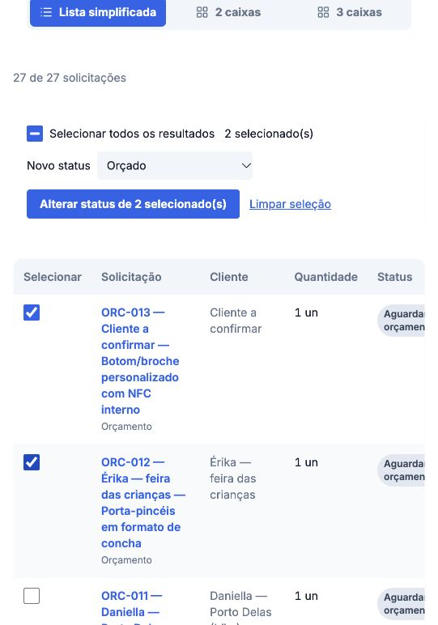

# Status em lote e filtro da lista do bot

## Orçamentos

Cada solicitação pode ser selecionada por checkbox na lista ou em cartões de duas/três colunas. A barra permite selecionar todos os resultados atuais, escolher um dos cinco status existentes e aplicar somente aos selecionados. Limite de 100 por operação. Mudar busca/status limpa a seleção; alternar a visualização a preserva. Itens removidos do resultado por atualização em tempo real não entram no envio.

A gravação é um `writeBatch` atômico do Firestore com apenas `status` e `updatedAt`, passando pelas mesmas regras de autorização/validação da edição individual. Não recalcula valores, move estoque, altera quantidade, nem preenche automaticamente datas de aprovação, pagamento ou produção. As regras publicadas permitem mudança de status por proprietário/administrador; permissões não foram ampliadas. Falha de conexão não é anunciada como sucesso; a seleção permanece disponível para conferência/repetição. Ausência de documento ou recusa de permissão impede todo o lote, sem salvamento parcial.

## Bot

A lista abre com **Aguardando orçamento e Orçado**. O seletor também oferece todos os status e cada status individualmente. Filtro mantido ao abrir e voltar de um pedido; mudar filtro substitui a página e reinicia o cursor.

`GET /api/assistant?status=active|all|<status>` valida a opção. Sem parâmetro conserva o contrato anterior (todos). Em atendimento compartilhado o servidor aplica a condição antes da paginação de 100 registros, usando `status in [...]` e ordenação por ID. Em links individuais a opção filtra os até 100 pedidos recentes já autorizados. Não afeta a pesquisa conversacional: o bot continua podendo consultar um pedido de qualquer status autorizado.

## Validação e publicação

Testes direcionados à lista, bot e permissões, sem executar a suíte completa do LabLayer. Resultado: 26 testes unitários/UI e 39 de integração/permissões aprovados na release (65). TypeScript e build aprovados; permanece aviso já existente de bundle acima de 500 kB. No repositório principal, TypeScript, 17 testes de UI e 22 de integração afetados também passaram. Nenhuma regra Firestore nem dado real é modificado pela publicação; o lote será executado apenas quando o usuário selecionar e aplicar.

Publicado código `260ed62`, com backup `/home/lablayer/deploy-backups/requests-bulk-20261021-before.tar.gz`. Health check e hashes local/remoto conferidos. Smoke publicado com tenant sintético cobriu filtro inicial, todos, cinco status individuais, filtro inválido e preservação dos 27 pedidos reais (9 verificações). Fixture removida após execução. Evidência: [resultado JSON](evidencias/orcamentos-filtro-status-20261021.json).

Conferência visual: checkboxes de dois orçamentos e botão de aplicação em lote habilitado, sem executar alteração real. Seleção limpa ao terminar. Filtro inicial do bot conferido na interface publicada.

