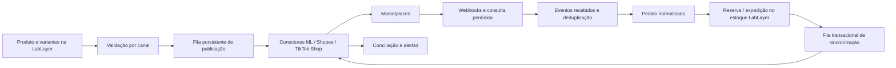

# Plano de integração de marketplaces — LabLayer

Data da pesquisa: 22/10/2026 (America/Sao_Paulo). Situação: plano de implementação; nenhuma conexão, autorização, publicação de anúncio ou alteração de estoque foi realizada nesta pesquisa.

Execução iniciada: [M0 — acessos e diagnóstico](./m0-acessos-diagnostico-20261022.md). Diagnóstico interno registrado; autorização e testes somente de leitura das três lojas permanecem pendentes. M0 ainda não concluído.

## 1. Decisão proposta e limites da verificação

Construir integrações no backend da LabLayer para cadastrar anúncios de produtos, importar pedidos e sincronizar disponibilidade. Começar pelo Mercado Livre, habilitar Shopee e TikTok Shop conforme acesso e homologação de cada conta. Iniciar a verificação dos três aplicativos em paralelo, sem condicionar o primeiro piloto à aprovação dos outros.

“Anúncio” neste plano é a ficha de produto à venda no marketplace. Campanhas pagas, vídeos, lives e programas de afiliados são evoluções separadas. O preço de venda por canal deve considerar suas condições comerciais, sem copiar automaticamente o preço de um orçamento direto ao consumidor.

A existência de APIs não confirma permissões nas contas do usuário. Não foram realizadas chamadas autenticadas às contas dos marketplaces. A disponibilidade de endpoints, campos, logística e categorias deve ser registrada por loja durante M0.

| Canal | Publicação | Pedidos/eventos | Estoque | Resultado da pesquisa |
| --- | --- | --- | --- | --- |
| Mercado Livre | Confirmada na documentação oficial | Confirmados | Confirmado, com diferenças por modelo de estoque | Viável; confirmar autorização, categorias e logística da conta |
| Shopee | Pendente de conferência detalhada no console oficial | Confirmados em documentação oficial brasileira | Contrato de escrita pendente de conferência no console | Integração candidata; não considerar publicação/estoque homologados |
| TikTok Shop | Confirmada na documentação oficial | Confirmados | Confirmado por SKU e depósito | Viável; validar Brasil, tipo de aplicativo, permissões e revisão aplicável |

### Mercado Livre

A documentação permite criar publicações e atualizar preço/estoque. Novos desenvolvimentos precisam considerar **User Products**, em vez de fixar o contrato exclusivamente no formato antigo de anúncios. A operação candidata de criação é `POST /items`, adaptada à modalidade habilitada para o vendedor. Consultar categoria, atributos obrigatórios, variações, imagens e regras de publicação antes do envio. [Publicar produtos](https://developers.mercadolivre.com.br/pt_br/autenticacao-e-autorizacao/publicacao-de-produtos), [User Products](https://developers.mercadolivre.com.br/pt_br/publicacao-de-produtos/user-products).

Estoque tradicional e estoque multiorigem exigem caminhos diferentes: contas multiorigem usam User Products/localizações; alterar somente `available_quantity` em `/items` pode não atualizar o saldo. Estoque Full deve ser tratado separadamente do estoque próprio. [Gestão multiorigem](https://developers.mercadolivre.com.br/pt_br/autenticacao-e-autorizacao/gestao-de-estoque-multiorigem-user-products).

Para vendas, assinar os tópicos apropriados, incluindo `orders_v2`, e consultar o pedido atualizado. Receber rapidamente o webhook e processar em fila; implementar recuperação periódica além das notificações. [Notificações](https://developers.mercadolivre.com.br/produto-receba-notificacoes), [Orders](https://developers.mercadolivre.com.br/pt_br/gerenciamento-de-vendas/gerenciamento-de-vendas).

M0 deve concluir registro do app, redirect HTTPS, permissões de publicação e vendas, acesso offline quando aplicável e autorização da conta proprietária. [Guia de desenvolvimento in-house](https://developers.mercadolivre.com.br/pt_br/autenticacao-e-autorizacao/desenvolvimento-in-house).

### Shopee

A documentação brasileira confirma consulta de pedidos com `v2.order.get_order_list` e notificações de criação/mudança de status por Push Mechanism. Ela também descreve pedidos ainda não pagos, cancelamentos que restauram estoque na plataforma e reservas de campanhas. Essas mudanças precisam ser reconciliadas, para não contar o mesmo retorno duas vezes. [APIs de orders — Shopee BR](https://seller.br.shopee.cn/edu/article/16185).

O portal [Shopee Open Platform](https://open.shopee.com/) e os guias oficiais de [registro](https://open.shopee.com/developer-guide/12) e [autorização](https://open.shopee.com/developer-guide/20) retornaram HTTP 403 ao mecanismo de pesquisa. Portanto, esta investigação não certifica o contrato atual de publicação/estoque nem a elegibilidade da conta brasileira. Fontes de terceiros encontradas não substituem essa validação.

Checklist de descoberta para M0: procurar no API Reference oficial as operações de criação/edição de produto, upload de imagem, variações, preço, estoque e detalhes de pedido; confirmar a categoria do aplicativo, autorização da loja, credenciais, assinatura, ambiente brasileiro e acesso de produção. Os nomes `v2.product.add_item`, `v2.product.update_stock`, `v2.product.update_price`, `v2.media_space.upload_image` e `v2.order.get_order_detail` são candidatos a conferir, não contratos validados neste documento. Exportar ou registrar as páginas oficiais acessíveis no console antes de implementar os payloads.

**Critério de decisão:** liberar M5 somente após aprovação/acesso e testes oficiais. Se o acesso direto não estiver disponível, avaliar um hub já autorizado que ofereça API para a LabLayer, comparando cobertura, custo, webhooks e responsabilidade pelo estoque. Isso é uma alternativa a investigar, não uma integração já escolhida. Enquanto isso, o conector permanece desativado; operação manual deve ter saldo exclusivo, sem prometer estoque compartilhado automático.

### TikTok Shop

Há API de criação de produto (`/product/202309/products`), atualização de inventário por SKU/depósito (`POST /product/202309/products/{product_id}/inventory/update`) e consulta/notificações de pedidos. A versão de cada operação deve ser fixada e revalidada durante implementação; não há garantia de que todos os endpoints usem a mesma versão. [Create Product — atualização oficial](https://partner.tiktokshop.com/docv2/page/mdpqmff0), [Update Inventory](https://partner.tiktokshop.com/docv2/page/update-inventory), [Order API overview](https://partner.tiktokshop.com/docv2/page/order-api-overview).

Para uso apenas das próprias lojas, verificar o enquadramento como seller developer/custom app. Não assumir dispensa universal de revisão: tipo de app, categoria Connector, mercado e abrangência alteram o caminho de aprovação. [App review process](https://partner.tiktokshop.com/docv2/page/app-review-process).

O fluxo brasileiro possui operações e campos de nota fiscal e depósito próprios; o planejamento de expedição deve conferir `need_upload_invoice` e o envio da nota quando exigido. Não confundir subir uma nota existente com emitir NF-e. [Fluxo BR de pedidos, invoice e warehouse](https://partner.tiktokshop.com/docv2/page/br-market-updated-api-workflow-to-support-order-invoice-and-warehouse).

A documentação recente oferece webhook de mudança de inventário, com identificadores de idempotência. Deve ser usado para conciliação, sem somar simultaneamente o delta e o saldo resultante, nem debitar novamente a venda já importada. [Inventory Changed by Shop](https://partner.tiktokshop.com/docv2/page/nn6csp5o).

Há controle por categoria do app para acesso a dados pessoais do comprador, inclusive fiscais no Brasil. Solicitar somente o necessário ao fluxo operacional. [Buyer Personal Information Masking](https://partner.tiktokshop.com/docv2/page/pgd9hfyy).

## 2. O que foi encontrado na LabLayer

Foram inspecionadas duas linhas de código, que NÃO devem ser tratadas como uma única versão já publicada:

| Evidência | Constatação | Consequência |
| --- | --- | --- |
| Checkout de publicação `/tmp/lablayer-users-release-20261021/server.ts:1319` | Início OAuth ML; callback apenas registra o código e redireciona para sucesso, sem troca/persistência de tokens | Substituir o fluxo incompleto; não exibir “conectado” sem uma consulta autenticada confirmada |
| Mesmo arquivo, linha 1342 | Shopee retorna mensagem de simulação | Ainda não é integração operacional |
| Mesmo checkout, diretório `server` | Não foi encontrado conector TikTok Shop nem módulo `inventory.ts` | Não presumir sincronização existente |
| Produção `/var/www/lablayer/app/server.ts` | SHA256 igual ao checkout de publicação: `b758b202c629c95b9635b6a374e64cfe14f15bc4d6e4983521b93d0cf94456a0`; `server/inventory.ts` ausente | A divergência não é apenas de uma cópia local; o núcleo novo precisa de uma entrega coordenada |
| `LabLayer/server.ts:821` no ramo `fix/estabilizacao-e0` | Rotas de integrações antigas retornam 501 durante estabilização | Preservar bloqueio até os novos fluxos estarem prontos |
| `LabLayer/shared/catalog/model.ts` | Catálogo/variantes; SKU ainda permite vazio | Exigir identificação única para itens publicáveis e resolver duplicidades |
| `LabLayer/server/inventory.ts` e `shared/inventory/model.ts` | Comandos transacionais, saldo físico/reservado, eventos, idempotência, conciliação | Reutilizar esse domínio após homologação/migração; não criar outro saldo paralelo |
| `LabLayer/server/order-target.ts` | Alvos de atendimento ligados a `salesOrders`, com compatibilidade legada | Importador deve usar o domínio de pedidos, sem forjar uma aprovação de orçamento |
| `LabLayer/shared/pricing/engine.ts` | Cálculo decimal e políticas de preço | Estender/reutilizar para política por canal, com regras e custos explicitados |

Base de planejamento: release `7e47c57` e ramo de estabilização `413cda3`, antes deste documento. Não foram lidos segredos, alteradas rotas ou ativado o novo estoque. A fase de migração do tenant não foi certificada nesta pesquisa. Confirmá-la em M0.

**Pré-requisito:** consolidar release, frontend, backend, regras Firestore e domínios E0–E5, preservando o bot, usuários, imagens e orçamentos recentes. Evitar publicar um ramo inteiro por cima do outro. A migração de estoque precisa de ensaio em cópia, conciliação e corte controlado, conforme `docs/implementacao/etapa-e3.md`.

## 3. Experiência de uso desejada

1. Cadastrar produto/variante na LabLayer: SKU, descrição, fotos próprias para venda, dimensões, peso do pacote, categoria, acabamento, preço e disponibilidade.
2. Na aba **Canais de venda**, selecionar as lojas, ajustar categorias/atributos e preço por canal. Mostrar campos faltantes e margem estimada.
3. Oferecer modo manual inicialmente e depois **Publicar automaticamente quando estiver pronto** por produto/canal. Produto incompleto permanece pendente com motivo visível.
4. Criar a publicação, gravar o identificador externo e acompanhar moderação. Sucesso HTTP não significa anúncio ativo: mostrar “enviado”, “em análise”, “ativo”, “recusado” ou “erro de sincronização”.
5. Ao receber pedido, importar uma única vez, reservar disponibilidade e atualizar os outros canais. Exibir pedido, canal, itens, situação e exceções na LabLayer.
6. No painel de integração, mostrar último contato, saldo desejado/confirmado, erro, tentativas e ação de reprocessamento seguro.

Orçamentos atuais não viram anúncios públicos automaticamente. Muitos são sob medida, possuem preços por lote, imagens de conversa e artes de clientes. É necessária conversão explícita para um produto publicável, com fotos selecionadas e unidade comercial definida. A imagem privada de um orçamento não deve tornar-se pública apenas porque o produto foi vinculado.

Kit com 10 chaveiros é uma unidade comercial composta por 10 peças. O conjunto de cinco organizadores de Lívia é 1 kit de cinco componentes. Não usar os preços alternativos de um orçamento como cinco SKUs nem como saldo pronto disponível. Produtos personalizados sob encomenda entram depois do piloto, conforme prazo e modalidade aceitos por cada canal; não anunciar capacidade de impressão como estoque físico.

## 4. Arquitetura proposta

Implementar módulos no backend TypeScript existente e um processo worker separado. Manter Firestore inicialmente: eventos de entrada persistidos e uma outbox criada na MESMA transação que altera a reserva/saldo. Uma fila persistente com lease, prazo de recuperação, tentativa, versão e deduplicação pode ser operada pelo worker. Não depender de tarefas em memória; não exigir migração de banco ou microsserviços para este primeiro volume.

O n8n pode receber eventos minimizados para alertas, resumos e tarefas auxiliares. A decisão de reserva, baixa, estorno e publicação de saldo pertence ao domínio transacional da LabLayer. IA pode sugerir descrições futuramente; não decide quantidade, pagamento ou baixa de estoque.

Coleções propostas, sempre subordinadas ao tenant:

| Registro | Responsabilidade |
| --- | --- |
| `channelConnections` | Loja/canal, permissões, situação da autorização, referência protegida dos tokens |
| `channelListings` | Vínculo produto/variante ↔ anúncio/SKU externo/depósito; configuração e situação por canal |
| `marketplaceOrders` | Identidade externa, versão/estado recebido, linhas e ligação ao pedido interno |
| `integrationInbox` | Evento autenticado recebido, processamento e deduplicação |
| `integrationOutbox` | Publicações/atualizações pendentes criadas atomicamente com a decisão local |
| `integrationRuns` | Resultado, erro saneado, latência e recibos; sem segredos |
| `stockAllocations` (se necessário) | Cotas por canal/depósito, separadas de reservas reais de pedidos |

Reutilizar `catalogItems`, `stockBalances`, `stockEvents`, reservas e `salesOrders`; não manter dois livros de estoque. Refatorar comandos de domínio para chamadas autenticadas de trabalhadores internos, sem inventar usuário humano ou escrever diretamente nos campos legados. Revisar limites de paginação/conciliador antes de escalar.

## 5. Regras de estoque e pedidos

### Saldo e unidade de medida

Para cada variante e depósito próprio:

`disponível = máximo(0, físico_utilizável − reservas_ativas − margem_de_segurança)`

Saldo físico utilizável já exclui avarias/quarentena. Reservas incluem vendas de TODOS os canais e compromissos locais. Bloqueios de campanhas devem entrar uma única vez no modelo, sem duplicar uma reserva já representada. Estoque em Full/depósitos de terceiros deve ficar separado do saldo próprio.

- Venda reconhecida: reduzir disponibilidade por reserva atômica. Não esperar o pedido concluir para informar aos demais canais.
- Pedido não pago: adaptar a reserva ao momento em que a plataforma comprometeu o estoque; manter até cancelamento/expiração autoritativos. A regra exata por status será homologada por conector.
- Pagamento confirmado: atualizar situação financeira; não debitar novamente.
- Expedição: converter a reserva em saída física uma única vez. Exemplo: físico 10/reservado 1 → físico 9/reservado 0; disponível continua 9, não cai para 8.
- Cancelamento antes da saída: liberar apenas a reserva remanescente. Cancelamento parcial opera por linha e quantidade.
- Reembolso/devolução após expedição: não repor automaticamente por evento financeiro. Exigir recebimento e condição utilizável, pelo fluxo de devolução existente.
- Pedido externo sem saldo ou sem SKU correspondente: persistir a venda, sinalizar exceção e impedir nova oferta indevida; não descartar o pedido nem fabricar saldo negativo silencioso.

### Concorrência entre marketplaces

As APIs não participam de uma única transação distribuída. Webhook rápido reduz o risco, mas não garante que dois compradores não comprem a última peça ao mesmo tempo.

Proposta de operação: estoque compartilhado com margem de segurança para itens com folga; cotas exclusivas para itens escassos e peças únicas. No piloto, usar cotas conservadoras. A soma das cotas livres deve respeitar a disponibilidade física restante. Transferir cota de um canal para outro exige confirmar a redução no primeiro e reconciliar vendas pendentes antes de aumentar no segundo. Nenhuma promessa de “zero overselling” apenas com sincronização.

Enviar saldos absolutos conforme o significado exigido por cada API: validar se o campo representa estoque vendável, total do vendedor ou quantidade por depósito. Não enviar cegamente o mesmo número para todos os endpoints. Reservas/campanhas e descontos automáticos do próprio marketplace entram nessa tradução.

Serializar atualizações por loja/SKU, descartar jobs obsoletos, verificar versões antes do envio e conferir o saldo remoto depois. Evitar que um retry antigo de saldo 10 sobrescreva saldo 8. Reconciliar pedidos antes de aumentar estoque; não restaurar um saldo remoto menor sem investigar uma venda ainda não recebida.

### Kits e personalização

Para kit montado a partir de componentes, a disponibilidade teórica é `mínimo(piso(disponível_componente / consumo_por_kit))`. Reservar todos os componentes atomicamente e considerar consumo compartilhado com outros kits/produtos. Não somar saldo de kits prontos com o dos componentes já consumidos na montagem. O piloto pode excluir kits para reduzir escopo, mas a decisão de unidade comercial deve existir desde M1.

Produtos sob encomenda requerem planejamento de capacidade, prazo de fabricação e regras de anúncio do canal. Para o piloto, selecionar produtos acabados e repetíveis, com SKU e estoque físico conferidos.

## 6. Proteções operacionais necessárias

- Conexões administradas por usuário autenticado e autorizado no tenant. O link público do bot de vendas não dá acesso a tokens, dados completos de compradores nem comandos de sincronização.
- Tokens/segredos no servidor, protegidos em repouso e com renovação controlada; nunca no frontend, URL pública, logs ou conversas. Autorização ligada a uma sessão e tenant; validar `state` e os mecanismos específicos de cada provedor. Remover o log de código OAuth do esboço antigo.
- Verificar autenticidade dos eventos conforme cada plataforma. Não presumir que todas usam a mesma assinatura. Resolver loja → conexão → tenant a partir do vínculo verificado. Consultar apenas recursos/hosts permitidos para impedir uso de URLs arbitrárias recebidas em webhook.
- Deduplicação de evento e de efeito de negócio: chave composta por tenant, canal, loja, pedido, linha e operação. Eventos fora de ordem não revertem uma expedição ou recriam reserva já encerrada.
- Webhook confirma recebimento após persistência durável; processamento externo posterior. Timeout, HTTP 429/5xx e expiração de token têm tratamento distinto de erro de validação e falta de permissão.
- Retry com espera crescente e limite; falhas finais em fila de revisão. Timeout ao criar anúncio exige consulta/reconciliação antes de repetir, evitando duplicatas.
- Alteração manual no marketplace gera divergência rastreável. A política de preço/conteúdo pode preservar exceções por canal; disponibilidade fica subordinada ao livro central e às restrições remotas.
- Rotina periódica de recuperação de pedidos com janela sobreposta, paginação completa e checkpoint, além de conciliação de saldos. Frequência calibrada pelos limites das contas; metas iniciais de latência são medidas de serviço, não garantias das plataformas.
- Se um canal falhar, mostrar indisponibilidade, suspender aumentos e novas publicações nele, preservar os eventos e alertar. Uma tentativa de pausar também pode falhar; não mostrar “pausado” sem confirmação.

## 7. Etapas executáveis e critérios de passagem

Não avançar com falhas de regra de negócio abertas. Cada etapa gera commit próprio, evidências, documentação de operação e estratégia de reversão/compensação. Nenhum prazo de aprovação externa está prometido.

| Etapa | Entrega | Critério para concluir |
| --- | --- | --- |
| **M0 — Acesso e diagnóstico** | Matriz de capacidades das 3 lojas; confirmação de contas BR, app, permissões, logística, contratos oficiais da Shopee; inventário de versões LabLayer | Teste somente leitura por loja autorizada; decisões claras: habilitada, pendente ou não disponível; mapa do que está realmente publicado |
| **M1 — Base de catálogo e estoque** | Consolidar E0–E5 com funcionalidades publicadas; SKU único; variantes, kits/unidades, medidas de embalagem, fotos comerciais; ensaiar migração e abertura de saldos | Regressão dos domínios afetados, conciliação integral, bot/orçamentos preservados e nenhum escritor legado concorrente após o corte |
| **M2 — Motor de integração** | Conexões por tenant, inbox/outbox, worker, adaptadores, pedidos externos, deduplicação, reconciliação e painel | Testes de duplicação, ordem invertida, duas vendas concorrentes, token expirado, tenant incorreto e reinício entre gravação e envio sem perda/dupla baixa |
| **M3 — Mercado Livre: pedidos e saldo** | Vincular anúncios existentes por SKU/variante; ler pedidos em modo sombra; habilitar reservas e saldo após conferir abertura | Venda, pagamento, cancelamento, expedição e retorno controlados; estoque remoto confirmado; nenhuma duplicata de pedido |
| **M4 — Mercado Livre: publicação** | Produto LabLayer → validação → mídia → anúncio → moderação; edição, pausa e preços por canal | Repetição após timeout não duplica anúncio; campos faltantes bloqueiam envio; item publicado e vinculado ao SKU correto; venda desse item retorna à LabLayer |
| **M5 — Shopee** | Conector de pedidos, saldo e publicação usando os contratos e acessos comprovados em M0 | Mesmos testes; comprovar variações, reservas/cancelamentos, promoção e estoque real. Se acesso pendente, etapa permanece bloqueada sem prometer automação |
| **M6 — TikTok Shop** | Conector de produtos, SKUs/depósitos, pedidos, inventário e estados de moderação; caminho fiscal/logístico brasileiro definido | Venda e cancelamento no ambiente aplicável; sem baixa dupla com webhook de inventário; expedição operacionalmente possível com requisitos BR atendidos |
| **M7 — Piloto multicanal e automação** | 3–5 produtos simples, uma loja por canal, cotas/margem definidas; depois publicação automática dos produtos elegíveis | Período de observação com conciliação sem divergências inexplicadas, reprocessamento comprovado e operação documentada; expansão gradual |

M5 e M6 podem trocar de ordem conforme autorização e prioridade comercial. A liberação de escrita em qualquer canal exige M1/M2 e o piloto desse conector. M3 vem antes de publicação ampla para que novas vendas já tenham caminho de importação e saldo.

## 8. Casos de qualidade obrigatórios

1. Evento repetido dez vezes produz um pedido e uma reserva.
2. Eventos em ordem inversa não reabrem pedido cancelado nem aumentam saldo indevidamente.
3. Duas vendas concorrentes da última unidade geram tratamento de falta, nunca saldo fictício ou descarte de pedido.
4. Venda local/manual também reduz disponibilidade dos canais; reserva de produção e de expedição não se confundem.
5. Pagamento e expedição não repetem a baixa; cancelamento parcial libera só o remanescente.
6. Devolução financeira sem recebimento físico não repõe estoque.
7. Venda de kit consome a quantidade correta de cada componente; peça única não fica livre em três cotas simultâneas.
8. Variações de cor/tamanho atingem o SKU correto; SKU desconhecido vai para revisão.
9. API retorna 429/5xx, expira token ou cai após sucesso remoto: retry não duplica publicação nem pedido.
10. Worker reinicia após transação local: outbox retoma; job velho não sobrescreve saldo recente.
11. Webhook falso, conexão de outro tenant e chamada do bot público não alteram estoque nem expõem compradores.
12. Imagem privada de conversa não é enviada sem seleção comercial; mídia inválida produz erro legível.
13. Anúncio rejeitado ou moderado aparece com motivo e não como ativo.
14. Falha de um canal mantém a venda registrada, sinaliza saldo não confirmado e não passa uma falsa sincronização verde.
15. Conciliação paginada detecta pedido perdido durante indisponibilidade e aplica o efeito uma única vez.

Não rodar testes da aplicação inteira em cada edição de texto. Implementações executam unitários/integração/contratos do escopo alterado; M1 e marcos de liberação executam regressão de catálogo, preços, pedidos, estoque, tenant e fluxos existentes afetados. Homologação usa ambientes/usuários de teste oficiais quando disponíveis; não simular compra real ou pagamento sem um plano de teste autorizado.

## 9. Primeira entrega recomendada

Executar **M0 + desenho de M1**, sem publicar anúncios: validar os aplicativos das três contas, resolver a documentação restrita da Shopee, identificar a fase de estoque da empresa e preparar a consolidação das versões. Selecionar depois um produto acabado simples e uma loja Mercado Livre para o primeiro ciclo completo.

Pendências de negócio a resolver nessa etapa: contas exclusivamente próprias ou futura integração de outros tenants; anúncios já existentes a vincular; uso de Full/estoque de terceiros; produtos prontos versus sob encomenda; preço mínimo por canal; modelo de nota fiscal/expedição; política de cotas para últimas unidades. Até essas definições, os conectores permanecem sem escrita de produção.
