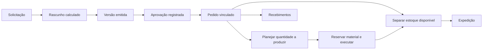
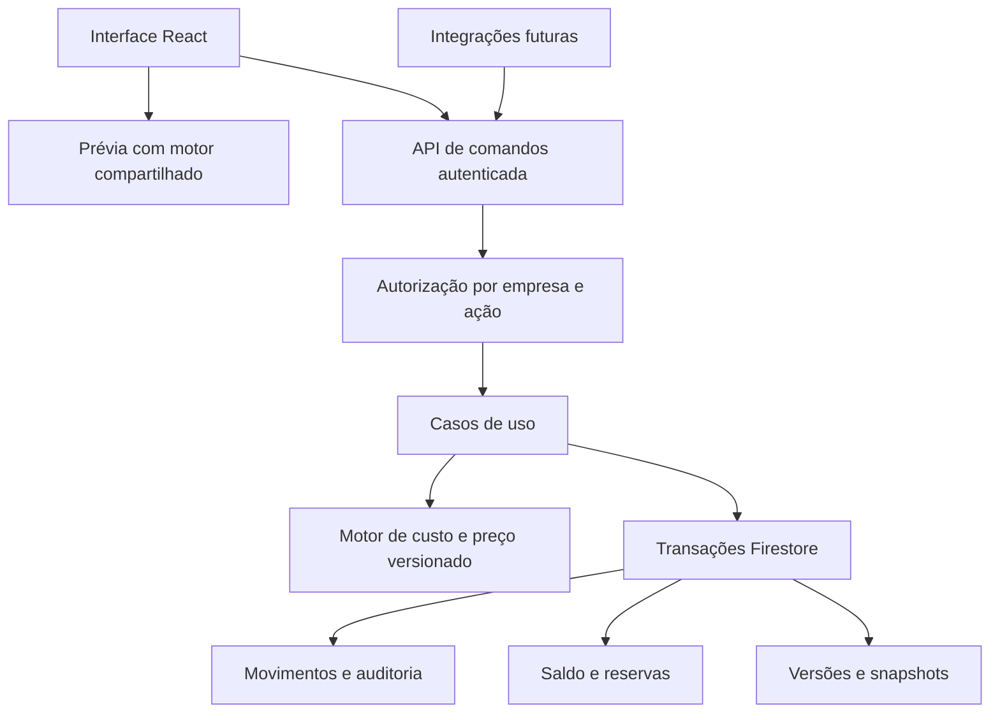

# Plano de correção e estabilização do LabLayer

Proposta de 5 de outubro de 2026, com visão de produto, engenharia e arquitetura. O objetivo é tornar confiáveis os cálculos e o funcionamento básico de produtos, orçamentos e estoque. A implementação deve evoluir a base existente e preservar registros; este documento não altera o sistema nem representa implantação aprovada.

A recomendação é trabalhar em seis etapas com critérios de conclusão: proteger os dados, unificar o cálculo, separar ficha de produto de produção, reconstruir o controle de estoque, conectar o orçamento ao pedido e fechar a conciliação operacional. Novos agentes e conectores entram depois que esses mesmos fluxos funcionarem manualmente.

## Resultado esperado da primeira estabilização

Ao final, deve ser possível cadastrar um produto sem consumir material; calcular uma mesa ou lote com custo explicado; montar orçamento com quantidade, versão e preço estáveis; registrar aprovação e pedido sem recadastrar tudo; reservar material, concluir produção e expedir com saldos corretos; e consultar custo e margem da venda com as premissas da época.

“Arrumar o básico” inclui tratar erros e repetições: conexão perdida, duplo clique, dois usuários editando, ausência de custo, material insuficiente, perda de impressão e cancelamento. Um fluxo que só funciona no caminho ideal não encerra a etapa.

## Base e recorte

O plano parte das [35 divergências mapeadas](/Users/PCNOTES/Workspace/3D/lablayer/LabLayer/docs/mapeamento/05-conferencia-e-divergencias.md), das [24 caracterizações existentes](/Users/PCNOTES/Workspace/3D/lablayer/LabLayer/docs/mapeamento/06-verificacao-e-decisoes.md) e das [quatro referências externas](/Users/PCNOTES/Workspace/3D/lablayer/LabLayer/docs/mapeamento/08-referencias-de-produto.md). Os hashes dos 42 arquivos da base foram conferidos novamente; não houve alteração desde o mapeamento inicial.

| Prioridade | Entra no trabalho de estabilização | Fica como evolução |
|---|---|---|
| Cálculos | Fórmula compartilhada, unidade/lote, insumos, perdas, máquina, trabalho, taxas e arredondamento | Otimização automática de preço, inferência de demanda, múltiplas moedas |
| Produtos | Identidade, variações, ficha versionada, componentes, arquivamento e estoque por movimentos | Catálogo público, gestão avançada de arquivos e versões de projeto |
| Orçamentos | Entrada manual simples, referência de arquivo/imagem, custo detalhado, versão, envio registrado, aprovação interna e pedido vinculado | Portal de aceite do cliente, assinatura, PDF elaborado, extração automática por IA |
| Estoque | Compra, abertura, reserva, consumo, perda, produção boa, expedição, ajuste e estorno | Compra sugerida por previsão, planejamento de demanda e otimização de lote |
| Integrações | Corrigir contratos e proteger rotas que já existem; definir comandos reutilizáveis | Novos marketplaces, importação inteligente, agentes autônomos |
| Financeiro | Preservar custo de venda, separar recebimento, impedir duplicações e reconciliar indicadores básicos | DRE gerencial ampliada, parcelamentos complexos, cobrança SaaS e automação fiscal |

## Ordem das entregas

| Etapa | Entrega percebida pelo usuário | Dependência | Critério para avançar |
|---|---|---|---|
| E0 — Proteção e contrato de entrada | Operações deixam de apagar dados ou permitir alterações indevidas | Base local e ambiente isolado | Regras de acesso, PATCH e criação repetida testados |
| E1 — Cálculo único | Mesmo cenário tem mesmo custo e preço em todas as entradas | Políticas de unidade e incidência documentadas | Casos de referência aprovados; motor e API equivalentes |
| E2 — Produto e ficha | Editar cadastro não representa produzir; componentes e variações têm significado claro | E1 e desenho da transição | Conversões sem perda de dados e casos ambíguos identificados |
| E3 — Estoque e execução | Compra/produção/expedição alteram saldo com histórico | E2; infraestrutura de movimentos pode ser desenvolvida antes | Conciliação fecha e repetição não duplica efeitos |
| E4 — Orçamento até pedido | Proposta estável, aprovação rastreável e produção vinculada | E1–E3 | Jornada completa funciona sem recadastro e sem dupla reserva |
| E5 — Fechamento e liberação | Painel, vendas e caixa deixam de contradizer a operação | E3–E4 | Piloto reconciliado e regressão aprovada |

E2 e E3 devem ser ativadas juntas por empresa: parar a baixa pelo editor sem entregar os comandos de produção deixaria a operação sem caminho de consumo. Desenvolvimento pode ser dividido; a liberação depende do conjunto.

## Etapa E0 para impedir novas inconsistências

| Item | Trabalho implementável | Evidência de conclusão |
|---|---|---|
| E0.1 | Criar ambiente de teste isolado e suíte mínima com os casos já reproduzidos; registrar versão local e implantada; preparar exportação completa paginada e ensaio de restauração | Nenhum teste usa dados de produção; restauração de uma cópia reconciliada |
| E0.2 | Proteger role/tenantId e concessão de privilégios; mover inicialização privilegiada de usuário/tenant para fluxo confiável no servidor; preservar acesso do dono legítimo | Usuário não pode trocar de empresa ou se promover; criação legítima de conta continua funcionando |
| E0.3 | Separar normalização de criação e atualização parcial; remover aliases após transformação; validar schema e referências; eliminar undefined no payload | PATCH só com status conserva título, preço, filamentos e datas; documento escrito pela API continua editável no fluxo suportado |
| E0.4 | Fazer POST com ID existente retornar conflito; derivar ator da autenticação; gravar auditoria de operações sensíveis junto com a alteração; exigir token nas entradas existentes | Repetição não sobrescreve; ator não é definido arbitrariamente por header; webhook sem credencial não grava |
| E0.5 | Suspender recálculo que reescreve histórico e impedir exclusão destrutiva de cadastro já usado; oferecer arquivamento | Custo/preço histórico preservados e estoque não aumenta ao arquivar produto |
| E0.6 | Identificar importação/conectores incompletos na interface e retirar ações que aparentam concluir sem efeito | Usuário distingue recurso operacional de recurso planejado |

Essa etapa deve corrigir o caminho de provisionamento antes de bloquear a escrita de campos no perfil: apenas endurecer as rules pode quebrar a inicialização atual. Rotas administrativas antigas que puderem alterar saldo diretamente terão acesso restringido até serem convertidas para os comandos da E3.

## Etapa E1 para unificar custos e preços

1. Implementar um módulo puro de cálculo versionado, sem React, Firebase ou dependência de relógio. Contrato detalhado no [documento de cálculo proposto](/Users/PCNOTES/Workspace/3D/lablayer/LabLayer/docs/mapeamento/09-contrato-proposto-de-calculo.md).
2. Centralizar conversões de g/kg, W/kW, minutos/horas e parsing decimal brasileiro. Preservar zero válido e rejeitar entradas desconhecidas ou inviáveis.
3. Explicitar parcelas por unidade, mesa/lote e pedido. Incluir preparação e acabamento como tempo humano, insumos/embalagem, material com suporte/purga e despesas de canal com incidência definida.
4. Separar custo estimado, custo realizado, preço sugerido e preço aceito. Salvar entradas, parcelas, versões, avisos e origem dos parâmetros em cada orçamento emitido.
5. Adaptar catálogo, simulador, valores sugeridos, solicitações e API ao mesmo contrato. Evitar que cada consumidor escolha silenciosamente quais parcelas enviar. Trocar a leitura de `product.cost` na venda por snapshot válido, nunca por zero como fallback.
6. Rodar o novo cálculo lado a lado com o antigo sem sobrescrever preços ou propostas existentes. Mostrar motivo de cada diferença: unidade, parcela ausente, arredondamento ou cadastro incompleto.

**Aceite:** cenários equivalentes fecham com o mesmo total em todos os consumidores; margem e markup têm bases explícitas; falha e energia zero são respeitadas; item sem custo fica incompleto; taxa inviável gera erro compreensível; histórico enviado permanece imutável. “Recalcular” gera nova proposta, não altera a aceita.

**Limite importante:** corrigir a omissão de insumos é um defeito verificável; decidir que uma perda antiga era por lote ou por peça é interpretação. O motor novo deve recusar a conversão automática quando essa informação não existir.

## Etapa E2 para organizar produtos

| Item | Trabalho implementável | Aceite |
|---|---|---|
| E2.1 | Separar dados comerciais de produto/variação da receita de fabricação e da execução de mesa | Alterar descrição, preço ou receita não escreve estoque |
| E2.2 | Remover reconstrução implícita de estoque por nomes/materiais; introduzir ID de componente e quantidade necessária | 10 bases + 6 tampas representam componentes e 6 conjuntos montáveis, não 16 produtos acabados |
| E2.3 | Versionar receitas e manter referência nos documentos que as usaram | Nova receita não muda custo de uma venda ou proposta passada |
| E2.4 | Preservar material, purga, suporte, unidade e tempo em conversões | Abrir/salvar sem alteração não perde 0,4 g nem zera purga |
| E2.5 | Unificar tipologia: produto permanece catálogo; orçamento/encomenda passa pelo módulo de solicitações/pedidos | Registro antigo é classificado com rastreio, sem criar automaticamente cópia e saldo |
| E2.6 | Arquivar em vez de excluir registros referenciados; exigir IDs estáveis nas vendas e produção | Nome pode mudar sem quebrar vínculos ou juntar produtos distintos em relatório |

A tela básica deve pedir nome, variação, receita, rendimento e componentes apenas quando necessários. As configurações avançadas ficam acessíveis sem esconder qual base foi usada no cálculo. Arquivos e imagens passam para armazenamento próprio, com referência no cadastro, sem payload grande incorporado ao documento.

## Etapa E3 para controlar estoque e produção

**Um único saldo físico, uma reserva separada e um histórico de movimentos.** Dashboard, filamentos, produtos e alertas leem essa mesma projeção. O botão de conciliação não recalcula consumo a partir da ficha; compara movimentos e saldos e propõe ajustes identificados.

| Operação | Efeito proposto | Proteção necessária |
|---|---|---|
| Registrar compra recebida | Entrada física e atualização de valor/custo médio | Compra e entrada vinculadas; retry não duplica |
| Confirmar plano de produção | Reserva dos materiais necessários | Validar disponibilidade; falta é informada, não truncada em zero |
| Registrar execução concluída | Consumo efetivo, liberação da reserva correspondente, entrada de unidades boas, perdas e horas | Transação por execução; permite reimpressão explícita e conclusão parcial |
| Montar produto composto | Baixa componentes e dá entrada em produto acabado | Receita versionada e quantidade inteira montável |
| Reservar produto para pedido | Reserva de unidades acabadas | Não reservar o mesmo saldo para dois pedidos |
| Expedir | Baixa de acabado e liberação da reserva consumida | Expedição ligada ao pedido, sem depender do estado financeiro |
| Cancelar ou corrigir | Liberação de reserva ou movimento compensatório, conforme execução real | Não devolver material já transformado por simples troca de status |
| Ajustar inventário | Diferença explícita de contagem/valor | Motivo, responsável, origem, versão e data |

O primeiro fluxo pode trabalhar com uma variação de saída por execução; impressão multicolorida continua tendo vários materiais e apenas uma contagem de produtos bons. Ordens maiores são divididas em execuções limitadas. Não repartir uma única operação física em vários commits parcialmente válidos sem protocolo explícito.

**Aceite:** abertura + entradas − saídas + ajustes fecha com o saldo; reservas não alteram saldo físico; duplo clique não produz duas entradas; duas reservas concorrentes não excedem disponibilidade; consumo acima do previsto exige disponibilidade adicional; excluir/arquivar cadastro não restaura filamento; toda diferença tem evento rastreável.

## Etapa E4 para completar a jornada do orçamento

Proposta de fluxo comercial: solicitação → rascunho → emitido → aprovado, recusado ou expirado. Revisão cria uma nova versão e identifica a anterior como substituída. Cancelamento é ação com motivo; pedido e produção têm seus próprios estados. Datas de aprovação não podem ser livremente digitadas como se substituíssem o evento.



| Item | Entrega | Aceite |
|---|---|---|
| E4.1 | Cadastro rápido por produto existente ou peça avulsa, quantidade, descrição e referência visual | Peça avulsa pode ser orçada sem poluir o catálogo e sem baixar estoque |
| E4.2 | Prévia com custo aberto, base de lote, itens, despesas de pedido, meta, desconto e total | Total e unitário reconciliam; campos incompletos têm indicação específica |
| E4.3 | Emitir uma versão com prazo de validade e preço congelado | Mudança de filamento/energia não altera documento enviado |
| E4.4 | Aprovação interna por operador autorizado, registrando quem informou, quando, canal e evidência do aceite | Não simular aceite autenticado do cliente; portal público fica para evolução |
| E4.5 | Aprovar cria um único pedido com referências de versão e receita | Repetir aprovação devolve o mesmo pedido; versão substituída não pode ser aceita silenciosamente |
| E4.6 | Planejar atendimento por estoque existente ou fabricação da falta | Aprovação não implica material disponível; pedido pode ficar aguardando alocação sem reserva falsa |
| E4.7 | Separar pagamento da produção e expedição | Uma produção pode ser planejada sem inventar recebimento; política de sinal é configurada depois de decidida |

Ao mudar uma versão já aceita, abrir revisão comercial e tratar o impacto no pedido por ação explícita. O planejamento deve liberar ou ajustar reservas somente após verificar o que já foi consumido. Um orçamento aprovado não deve recriar venda/produção a cada salvamento.

## Etapa E5 para conciliar e liberar o núcleo

- Preservar custo estimado e realizado da produção/venda, com campos separados e origem. Não preencher custo antigo desconhecido com zero.
- Registrar compras de insumos por evento, sem recalcular compra passada pelo saldo remanescente.
- Separar receitas de pedidos de recebimentos pagos; contas previstas não compõem saldo realizado. Escolher uma única data para cada visão e normalizar fuso da operação.
- Reconciliar despesas de energia/manutenção com o custo gerencial para não somar duas vezes. Até isso existir, rotular corretamente a visão gerencial disponível.
- Fazer rankings usarem IDs; alinhar estados de impressora e política de alertas; remover afirmações de precisão de indicadores ainda incompletos.
- Testar cadastro→orçamento→aprovação→produção→expedição→recebimento, incluindo falta, falha, repetição, cancelamento e retorno da conexão.

**Aceite final:** um pedido representativo fecha quantidade, material, custo, preço, taxas e recebimento nas telas e na API; diferenças entre estimado e realizado são explicadas, não escondidas. O piloto fica sem divergência inexplicada antes de ampliar a ativação.

## Arquitetura proposta

Manter uma aplicação modular: React apresenta e valida a entrada; um módulo TypeScript puro calcula; Express autentica e executa comandos; Firebase persiste dados. A separação de responsabilidades permitirá que futuras integrações usem os mesmos comandos da interface.



Estrutura sugerida, a criar durante a implementação:

```text
shared/domain/       tipos, unidades, schemas e políticas
shared/pricing/      motor puro e resultados detalhados
server/application/ aprovar orçamento, receber compra, executar produção, expedir
server/repositories/ acesso ao Firestore e transações
server/http/         rotas, autenticação, erros e adaptadores legados
src/features/        telas e componentes organizados por domínio
tests/               cálculo, contratos, rules, concorrência e jornada
```

Não é necessário trocar banco, framework ou criar microserviços para corrigir o problema atual. A principal mudança é que cálculos e efeitos deixam de estar definidos separadamente em cada tela.

### Contratos e autoridade de escrita

| Domínio | Fonte de verdade proposta | Quem escreve |
|---|---|---|
| Custo/preço estimado | Motor e snapshot com versões | Servidor ao emitir; navegador somente prévia |
| Produto/ficha | Catálogo e versões de receita | Comando de cadastro/edição sem efeito físico |
| Saldo/reserva | Projeção transacional dos movimentos | Comandos de estoque; nunca formulário genérico |
| Aprovação | Evento e versão aceita | Operador autorizado ou futuro mecanismo autenticado de aceite |
| Custo realizado | Execuções e consumos concluídos | Comando de produção e rateio definido |
| Recebimento | Evento financeiro vinculado | Confirmação explícita de pagamento |

Reaproveitar `products`, `customRequests`, `productionOrders` e `orders` quando o significado for preservado, adicionando `schemaVersion` e adaptadores de leitura. Novas estruturas previstas: versões de receita/orçamento, compras, saldos, reservas, movimentos genéricos por tipo de item e recibos de comando. O `inventoryMovements` legado tem formato focado em filamento: não tratá-lo automaticamente como o novo livro de todos os itens.

Todos os dados operacionais ficam no tenant. Credenciais humanas chegam por autenticação Firebase; chaves de serviço recebem empresa e escopos de ação. O servidor verifica vínculo e permissão; não aceita tenant ou ator arbitrários do corpo como autoridade. Campos `role`, `tenantId` de concessão e plano/status administrativos têm caminho controlado. Isso é indispensável porque bibliotecas de servidor não passam pelas rules de cliente. [Documentação oficial de condições de segurança](https://firebase.google.com/docs/firestore/security/rules-conditions).

### Comandos e repetição

Contratos propostos: `CalculateQuote`, `SaveRecipe`, `IssueQuoteVersion`, `ApproveQuote`, `ReceivePurchase`, `ReserveStock`, `CompleteProductionRun`, `AssembleProduct`, `ShipOrder`, `RecordPayment` e `ReverseMovement`. Os nomes são de casos de uso, não rotas já existentes.

Cada mutação recebe chave de idempotência, versão esperada e payload validado. A transação verifica recibo anterior, estado atual, referências e disponibilidade; grava novo estado, movimentos, auditoria e resultado do comando juntos. Uma chave repetida com mesmo conteúdo retorna o resultado anterior; conteúdo diferente retorna conflito. IDs necessários são estáveis durante tentativas.

Usar transação para decidir com base no saldo corrente. Firestore pode repetir o callback quando houver edição concorrente; ele não deve enviar mensagem, chamar marketplace nem realizar outro efeito externo. O limite de itens por execução deve ser validado na implementação. [Documentação oficial de transações](https://firebase.google.com/docs/firestore/manage-data/transactions).

Quando houver notificações futuras, gravar uma tarefa de envio junto ao comando e entregá-la após confirmação, com seu próprio identificador de repetição. A primeira estabilização não depende de um sistema distribuído de eventos.

## Migração e liberação gradual

1. **Inventariar a base real:** comparar versão implantada, rules, coleções, unidades e permissões. Exportar tudo com paginação e contagem; o export atual limitado não é backup completo.
2. **Classificar legado:** separar fichas, produção histórica, orçamentos misturados em produtos, vendas sem custo e referências órfãs. Registrar `needsReview` para o que não puder ser inferido com confiança.
3. **Preparar conversão em cópia:** preservar IDs e dados originais; mapa de transformação e relatório antes/depois; conversões determinísticas e repetíveis.
4. **Definir abertura por empresa:** reconciliar físico e valor com contagem/documentos disponíveis. Criar eventos de abertura na data de corte. Não inventar movimentos históricos a partir das fichas.
5. **Calcular em paralelo sem escrever saldo:** comparar motores e projeções em modo de conferência. Explicar divergências e validar amostra com operador.
6. **Cortar os escritores antigos:** breve janela de manutenção do tenant; desabilitar alterações antigas no navegador, nas rules e na API; reconciliar mudanças desde a cópia; aplicar abertura e habilitar comandos novos como único caminho de escrita.
7. **Ativar conjunto coerente:** E2/E3 juntas para estoque; E4 apenas quando usar essas mesmas operações. Versões antigas de navegador recebem pedido de atualização e não continuam gravando no saldo antigo.
8. **Acompanhar o piloto:** conferir movimentos versus saldos, reservas órfãs, comandos repetidos, erros de autorização, snapshots e totais de pedidos. Expandir somente com diferenças explicadas.

Não manter os dois modelos alterando o mesmo saldo durante a transição. Projeções legadas, se necessárias temporariamente, devem ser atualizadas pelo servidor como espelho; não viram segundo escritor.

**Recuperação:** antes do primeiro movimento novo, é possível restaurar a cópia validada. Depois de novas operações físicas, restaurar cegamente o banco perderia fatos reais. Nesse caso, pausar mutações, preservar os movimentos/recibos e corrigir para frente ou reconstruir a projeção. Uma versão anterior da interface só pode voltar se respeitar o novo contrato de escrita.

## Testes necessários por risco

| Nível | Casos obrigatórios | Etapa |
|---|---|---|
| Unitário do motor | Conversões, custo aberto, margem/markup, falha zero, denominador inválido, lote parcial, trabalho humano e arredondamento | E1 |
| Propriedades do cálculo | Soma das parcelas fecha total; reordenar materiais não muda custo; valores finitos; nenhum custo desconhecido vira zero | E1 |
| Contrato UI/API | Mesmas entradas e versões produzem mesmo resultado; aliases removidos; PATCH conserva omitidos | E0–E1 |
| Segurança em emulador | Separação entre empresas, campos de concessão, ações por papel e rejeição de escritores legados | E0/E3 |
| Transações | Dois usuários reservam o último saldo; retry de conclusão/compra; mesma chave com payload diferente; falha antes/depois do commit | E3 |
| Migração | Peso/purga preservados, IDs mantidos, abertura conciliada, rerun sem duplicar, casos ambíguos isolados | E2–E3 |
| Jornada | Produto novo, orçamento avulso, revisão, aprovação repetida, falta de material, reimpressão, montagem, expedição e pagamento | E4–E5 |

Os 24 casos atuais documentam inclusive defeitos. Ao corrigir um defeito, converter seu cenário em teste de regressão com a nova expectativa e manter a explicação da mudança; não usar o defeito como resultado obrigatório.

## Backlog de execução e dependências

P/M/G representam complexidade relativa, não prazo ou quantidade de pessoas. Datas só devem ser estimadas após amostra dos dados reais e confirmação das regras propostas.

| Pacote | Conteúdo | Depende de | Porte |
|---|---|---|---|
| B01 | Ambiente isolado, fixtures, exportação/restauração e regras de autorização/provisionamento | Nenhum | M |
| B02 | Correção de PATCH, schemas compatíveis, criação com conflito e auditoria | B01 | M |
| B03 | Interromper sobrescrita histórica/exclusão com devolução e comunicar recursos incompletos | B01 | P |
| B04 | Contrato de unidade/lote, falhas e incidências; motor puro e casos aprovados | B01 e decisões de cálculo | M |
| B05 | Consumidores compartilhados, snapshot e comparação antigo/novo | B02/B04 | M |
| B06 | Produto/variação/receita, componentes e adaptação da tela | B04 | G |
| B07 | Compras, movimentos, saldos, reservas, idempotência e abertura | B02/B06 | G |
| B08 | Execução, montagem, perdas, expedição e estornos | B07 | G |
| B09 | Versões de orçamento, aprovação e pedido vinculado | B05/B08 | G |
| B10 | Custo de venda, recebimento e reconciliação de indicadores | B08/B09 | M |
| B11 | Ensaio de migração, corte de escritores, piloto e documentação final | B06–B10 | G |

Desenvolver uma capacidade por alteração revisável, com critério de aceite e atualização de documentação. Alterações no motor não devem se misturar a redesenho visual amplo ou novo conector. A responsabilidade sugerida é engenharia pela implementação, revisão técnica pelos contratos, e responsável pela operação pela confirmação das premissas e da conciliação; não pressupõe uma equipe já disponível.

## Cobertura das divergências

| Divergências | Tratamento previsto |
|---|---|
| DV01–DV10 | E1/B04–B05: motor, parcelas, unidades, snapshots, parâmetros e arredondamento |
| DV11–DV12 | E2/E3/B06–B08: cadastro sem consumo e conclusão transacional |
| DV13–DV14 | E0/E3/E5: arquivamento, expedição, recebimentos e reversões |
| DV15–DV16 | E2: componentes, receitas e conversão sem perda |
| DV17–DV19 | E3: concorrência, idempotência, movimentos, perdas e horas reais |
| DV20 | E3 adiciona impressora por execução; capacidade e conflitos avançados ficam para evolução |
| DV21–DV24 | E5: compras por evento e reconciliação; política contábil ampliada fica para etapa própria |
| DV25 | E4: estados, versões, aprovação e vínculos |
| DV26 | E5 corrige estado do painel; oferta e cobrança SaaS têm backlog separado |
| DV27–DV31 | E0/E3: autorização, schema, comandos e proteção dos endpoints atuais |
| DV32 | E0 comunica o que funciona; implementação de conectores/importação fica para evolução |
| DV33 | E0 pagina exportação; módulos alterados recebem leitura limitada; otimização adicional guiada por medição |
| DV34 | E2/E3: mídia fora dos documentos, execução com tamanho controlado, histórico em registros próprios |
| DV35 | Correção pequena independente no site: confirmação verificável; não bloqueia o núcleo operacional |

## Evoluções após o núcleo confiável

| Evolução | Benefício | Pré-condição |
|---|---|---|
| PDF e link de aprovação | Facilitar envio e aceite de propostas | Versão imutável e contrato de aceite |
| Importação CSV assistida | Subir produtos, compras e solicitações com menos digitação | Prévia, validação, chave externa e resultado por item |
| Assistente para ler briefing e dados de fatiamento | Preparar rascunho a partir de mensagem/arquivo | Contrato de unidade; entrada identificada como estimativa até revisão |
| Agente de integração WhatsApp | Organizar solicitações e atualizar cliente | Autenticação por tenant, deduplicação e comandos de negócio estáveis |
| Conectores de marketplace | Trazer pedidos e sincronizar disponibilidade | Pedido, reserva, expedição e reconciliação funcionando |
| Planejamento de capacidade | Melhorar promessa de prazo e uso da frota | Tempos reais, máquina atribuída e agenda consistente |
| Compra sugerida | Antecipar falta de material | Saldo/reserva confiáveis e histórico de demanda |
| Mais tecnologias e estratégias de preço | Atender resina e novos modelos comerciais | Custo modular e regras específicas validadas |

Agentes futuros podem extrair dados e propor ações. Cálculo, validação e persistência continuam determinísticos no servidor. Mensagem externa não altera preço aceito, privilégio, saldo ou pagamento fora dos comandos e permissões da operação.

## Primeiro incremento recomendado

Começar por B01–B04: proteger permissões e atualizações parciais, impedir destruição de histórico e construir o contrato de cálculo com os casos de referência. Em seguida, B05 entrega comparação de custos e conecta consumidores sem reprecificar o passado. A separação produto/produção e o estoque transacional vêm logo depois como uma liberação conjunta.

Antes da ativação com dados reais, precisam estar confirmados: significado de lote e unidade boa; incidência de fixos/perdas; política de contingência; evento de reserva/consumo; quantidade de componentes por produto; custo e saldo de abertura. Este plano já traz propostas para essas escolhas, detalhadas no [contrato de cálculo e estoque](/Users/PCNOTES/Workspace/3D/lablayer/LabLayer/docs/mapeamento/09-contrato-proposto-de-calculo.md), para que a revisão seja concreta.
