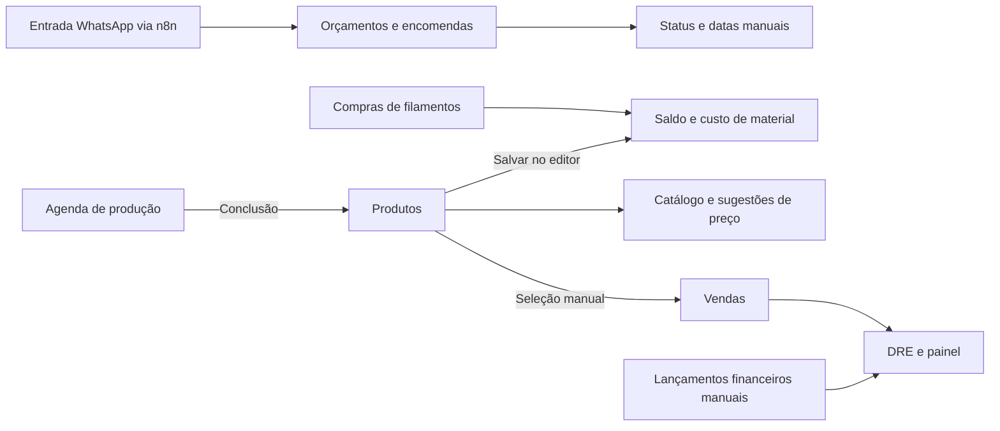

# Referência de negócio e cálculos do LabLayer

Esta documentação descreve o comportamento implementado no código local do LabLayer em 5 de outubro de 2026. Ela serve como base para revisar os números e, depois, planejar a evolução de orçamentos, encomendas, aprovações, produção e integrações.

**Conclusão da investigação:** o LabLayer já tem os principais cadastros e telas da operação, mas ainda não possui um fluxo integrado e uma referência única de custo, estoque e resultado financeiro. Há divergências reproduzíveis entre módulos. Portanto, os números atuais não devem ser considerados homologados apenas porque aparecem no sistema.

## Como consultar

| Documento | Conteúdo |
|---|---|
| [Regras e fluxos existentes](/Users/PCNOTES/Workspace/3D/lablayer/LabLayer/docs/mapeamento/01-regras-e-fluxos.md) | Regras por módulo, estados, ações e efeitos sobre outros registros |
| [Catálogo de cálculos](/Users/PCNOTES/Workspace/3D/lablayer/LabLayer/docs/mapeamento/02-calculos.md) | Fórmulas, unidades, entradas, defaults, arredondamentos e exemplos |
| [Modelo de dados e permissões](/Users/PCNOTES/Workspace/3D/lablayer/LabLayer/docs/mapeamento/03-dados-e-permissoes.md) | Entidades, vínculos, validações e acesso por empresa |
| [API e integrações existentes](/Users/PCNOTES/Workspace/3D/lablayer/LabLayer/docs/mapeamento/04-api-e-integracoes.md) | Contratos implementados, automações reais e interfaces incompletas |
| [Conferência e divergências](/Users/PCNOTES/Workspace/3D/lablayer/LabLayer/docs/mapeamento/05-conferencia-e-divergencias.md) | Código versus documentação e telas; pontos para a próxima análise |
| [Verificação e decisões pendentes](/Users/PCNOTES/Workspace/3D/lablayer/LabLayer/docs/mapeamento/06-verificacao-e-decisoes.md) | Evidências executáveis, limites da análise e decisões necessárias para homologar |

## Plano de melhoria

Os documentos 01–06 registram o comportamento existente. Os documentos abaixo propõem mudanças; suas fórmulas e fluxos ainda não estão implementados.

| Documento | Conteúdo |
|---|---|
| [Plano de correção e estabilização](/Users/PCNOTES/Workspace/3D/lablayer/LabLayer/docs/mapeamento/07-plano-de-correcao.md) | Seis etapas, arquitetura, backlog, dependências, migração e critérios de aceite; começar por este documento |
| [Referências de produto](/Users/PCNOTES/Workspace/3D/lablayer/LabLayer/docs/mapeamento/08-referencias-de-produto.md) | Comparação das quatro plataformas indicadas, cuidados com as fórmulas e ideias para agora/depois |
| [Contrato proposto de cálculo e estoque](/Users/PCNOTES/Workspace/3D/lablayer/LabLayer/docs/mapeamento/09-contrato-proposto-de-calculo.md) | Unidades, incidências, custo, preço, arredondamento, estoque e exemplo numérico de homologação |

## Base examinada

- Aplicação `LabLayer`: 18 arquivos de telas, navegação, autenticação, motor de custo, servidor Express, regras Firestore, documentação administrativa e workflow n8n.
- Site `SiteLabLayer`: comunicação das funcionalidades, planos, formulário de lista de espera e receptor em Google Apps Script.
- Commit local da aplicação: `0fd3cbe51c551036fc58bb60afd8d068ad642620`, de 25/08/2026. A data do levantamento não é a data de publicação dessa versão.
- Havia um diretório `scripts/` não rastreado antes do trabalho. Ele foi preservado.
- Os relatórios em `output/` e seus arquivos auxiliares em `tmp/` tratam de engenharia de outro contexto, conforme `tmp/pptx_engineering/source-notes.txt`; não foram usados como especificação de LabLayer.

O levantamento não acessou registros de clientes, credenciais, serviços em produção, implantação de regras ou integrações externas. A referência é o checkout local. Não houve alteração no código operacional nem correção de regra de negócio nesta etapa.

## O que existe no fluxo atual

O diagrama representa ligações encontradas no código. Alterar o status de um orçamento para `fila-producao` não cria uma ordem na agenda. Registrar uma venda não baixa o estoque nem cria recebimento no fluxo de caixa. Concluir produção aumenta produtos, mas não aplica a baixa de filamentos usada no editor do catálogo.

## Como interpretar as conclusões

**Implementado** significa que o comportamento foi encontrado em código. **Reproduzido** significa que uma função real foi executada localmente com entradas controladas. **Pendente de decisão** identifica uma regra que depende do significado pretendido para a operação. **Não verificado em produção** identifica limites de ambiente e implantação.

Os 24 casos de caracterização confirmaram o comportamento descrito. Isso inclui comportamentos incorretos ou ambíguos: passar nesses casos não significa que os cálculos estejam aprovados para uso comercial.

## Manutenção desta referência

Ao mudar uma regra, atualizar o documento correspondente, o cenário de verificação e a decisão de negócio que motivou a alteração. Manter separadas a regra vigente, a proposta de mudança e a migração dos registros antigos. Os links apontam para a cópia local examinada; números de linha podem mudar em revisões futuras.
